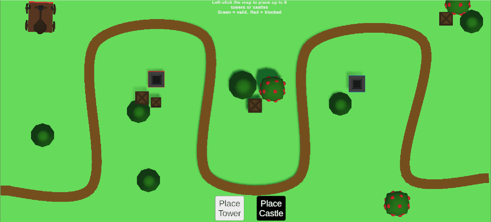
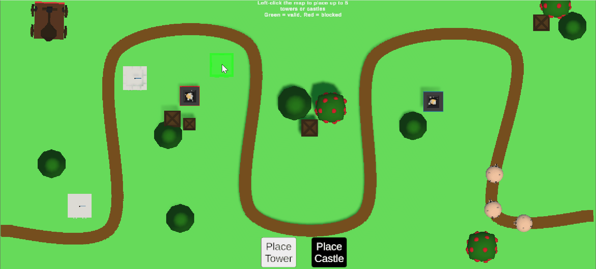

## Current Requirements Completed:

## Demo Functionalities

## Game Over 

### Minimum for a C grade:
- [x] The player can place towers.
- [x] Towers fire continuously at a set rate.
- [x] Towers aim directly at an enemy.
- [x] Enemies travel in predetermined straight-line paths. (This has since been changed as our paths are curved)
- [x] The game ends when an enemy completes its path of travel without being destroyed.

### Minimum for a B grade:
- [x]  There are at least two types of towers with different stats (rate of fire, projectile speed,
and tower height).
- [x] A textual overlay clearly conveys how to place towers.
- [x] Players have a limited number of towers that can be placed.
- [x] Enemy paths are not straight lines.

### Minimum for an A grade:
- [x] There are multiple enemy types with different statistics (speed and hp).
- [x]  The game includes non-basic assets.
- [x] Towers aim toward the predicted location of the target based on its current velocity and
location.
